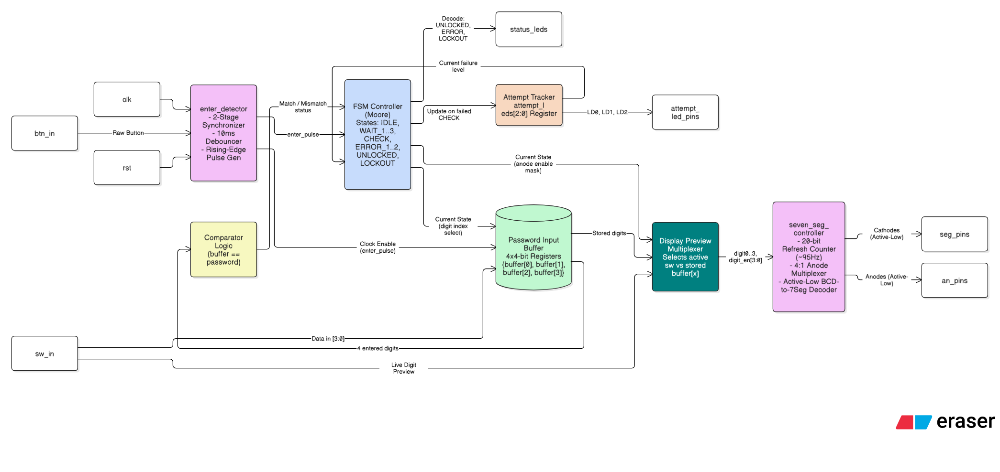
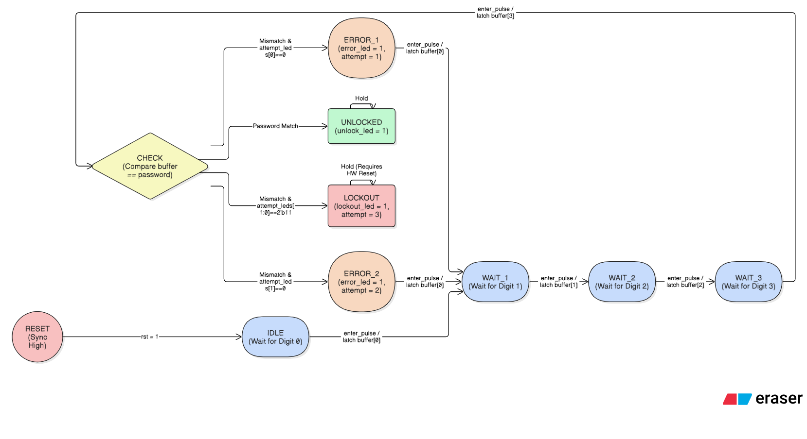

# FPGA Digital Combination Lock

A 4-digit digital combination lock implemented in **Verilog-2001** for the **Xilinx Artix-7 FPGA (Digilent Basys 3)**. The design incorporates a Moore Finite State Machine (FSM), synchronous datapath storage, physical pushbutton debouncing, single-cycle edge detection, an attempt-tracking security lockout system, and a time-multiplexed 4-digit 7-segment display driver with live switch preview.

---

## Architecture Overview

The system strictly adheres to the **Controller–Datapath Separation** paradigm:
* **Control Unit (FSM):** Orchestrates the operational phases of user entry, verification, and security states without cluttering states with arithmetic counters.
* **Datapath:** Maintains digit storage buffers, performs parallel password comparisons, and tracks cumulative attempt history.
* **Input Conditioning:** Cleans raw mechanical switch bounce and generates a single-clock-cycle pulse per human button press.
* **Display Subsystem:** Time-multiplexes entered digits across the 4 physical display anodes while providing live feedback of the current switch configuration.



---

## Finite State Machine (FSM)

The control unit is modeled as an 8-state Moore machine where high-level state decisions are decoupled from the physical attempt counter.



### State & Output Truth Table

Status LEDs are mutually exclusive and derived combinational outputs of the current state. The attempt LEDs are driven by the datapath attempt register.

| State | unlock_led | error_led | lockout_led | attempt_leds[2:0] | Description |
| :--- | :---: | :---: | :---: | :---: | :--- |
| **IDLE** | 0 | 0 | 0 | fail_count | Waiting for Digit 0 entry |
| **WAIT_1** | 0 | 0 | 0 | fail_count | Digit 0 latched; awaiting Digit 1 |
| **WAIT_2** | 0 | 0 | 0 | fail_count | Digits 0–1 latched; awaiting Digit 2 |
| **WAIT_3** | 0 | 0 | 0 | fail_count | Digits 0–2 latched; awaiting Digit 3 |
| **CHECK** | 0 | 0 | 0 | fail_count | 4-digit comparison against preset password |
| **ERROR_1** | 0 | 1 | 0 | 3'b001 | 1st invalid attempt; awaits retry |
| **ERROR_2** | 0 | 1 | 0 | 3'b011 | 2nd invalid attempt; awaits retry |
| **UNLOCKED** | 1 | 0 | 0 | Retained | Correct password entered |
| **LOCKOUT** | 0 | 0 | 1 | 3'b111 | 3rd failed attempt; system locked |

> **Global Reset:** A synchronous, active-high reset (`reset = 1`) has priority over all transition logic, forcing the state register to `IDLE` and clearing the input buffer and attempt registers back to zero from any state.

---

## Hardware Subsystems & Features

### 1. Pushbutton Conditioning (`enter_detector.v`)
Mechanical buttons bounce for 5 to 20 ms, generating noise that causes an edge-sensitive FSM to cycle through states erratically.
* **Metastability Protection:** A 2-stage D flip-flop synchronizer isolates asynchronous input pin transitions.
* **10 ms Counter-Based Debouncer:** Rejects any pulse that does not remain stable for 1,000,000 clock cycles (at 100 MHz).
* **Rising-Edge Detector:** Emits a single-cycle pulse (`enter_pulse`), ensuring that holding the button down advances the FSM by exactly one digit rather than running through all four in consecutive clock cycles.

### 2. Multi-Stage Security Lockout (`attempt_leds`)
The design allows **up to 3 sequential attempts** before locking down:
* **Attempt 1 Failed:** Lights `attempt_leds[0]` (`LD0`), asserts `error_led` (`LD14`), and awaits a retry via `enter_button`.
* **Attempt 2 Failed:** Lights `attempt_leds[1:0]` (`LD1:LD0`), asserts `error_led`, and awaits a retry.
* **Attempt 3 Failed:** Transitions directly into `LOCKOUT`, lights all attempt LEDs (`3'b111`), and asserts `lockout_led` (`LD13`).
* **Immunity:** In `LOCKOUT`, the FSM enters a self-loop that ignores subsequent inputs until a system administrator asserts a hardware `reset`.

### 3. Display Subsystem with Live Switch Preview (`seven_seg_controller.v`)
* **Time-Multiplexed Cathodes:** Scans across all four 7-segment display positions at ~95 Hz via a 20-bit counter (`refresh_counter[19:18]`).
* **Live Preview:** While configuring the switches for the next input, the active display digit updates in real time to match `sw[3:0]`.
* **Digit Retention:** Once `enter_button` is pulsed, the current digit is latched into `buffer[x]` and permanently frozen on the display as the next digit becomes active.

| State | Digit 3 (Leftmost, an[3]) | Digit 2 (an[2]) | Digit 1 (an[1]) | Digit 0 (Rightmost, an[0]) | Enabled Anodes |
| :--- | :--- | :--- | :--- | :--- | :---: |
| **IDLE / ERROR_1 / ERROR_2** | `sw[3:0]` (Live Preview) | Blank | Blank | Blank | `4'b1000` |
| **WAIT_1** | `buffer[0]` (Fixed) | `sw[3:0]` (Live Preview) | Blank | Blank | `4'b1100` |
| **WAIT_2** | `buffer[0]` (Fixed) | `buffer[1]` (Fixed) | `sw[3:0]` (Live Preview) | Blank | `4'b1110` |
| **WAIT_3** | `buffer[0]` (Fixed) | `buffer[1]` (Fixed) | `buffer[2]` (Fixed) | `sw[3:0]` (Live Preview) | `4'b1111` |
| **CHECK / UNLOCKED / LOCKOUT** | `buffer[0]` (Fixed) | `buffer[1]` (Fixed) | `buffer[2]` (Fixed) | `buffer[3]` (Fixed) | `4'b1111` |

---

## Repository Structure

```text
fpga-digital-combination-lock/
├── .gitignore
├── README.md
├── docs/
│   ├── fsm_state_diagram.png
│   ├── datapath_architecture.png
│   └── testbench_waveform.png
├── rtl/
│   ├── top_module.v
│   ├── enter_detector.v
│   └── seven_seg_controller.v
├── tb/
│   ├── tb_top_module.v
│   └── tb_seven_seg_controller.v
└── constraints/
    └── Basys-3-Master.xdc
```
